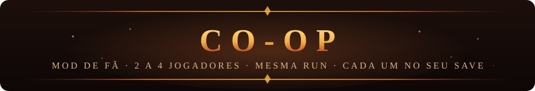
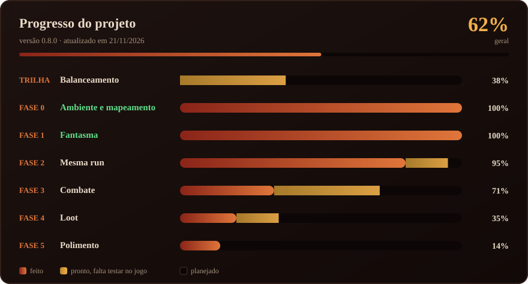
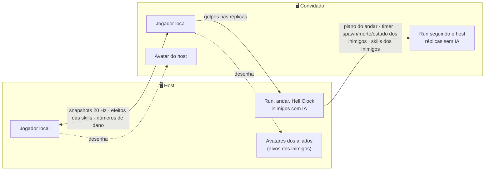

<a href="https://store.steampowered.com/app/1782460/Hell_Clock/"></a>

<p align="center">
  <a href="https://store.steampowered.com/app/1782460/Hell_Clock/"></a>
</p>

<p align="center">
  
</p>

<p align="center">
  
  
  
  
</p>

<p align="center">
  <b>Jogue Hell Clock com os amigos.</b> Mesma run, mesmos inimigos, um vendo as skills do outro —<br>
  e cada um com a própria progressão, no próprio save.
</p>

<p align="center">
  <a href="https://github.com/SrMackenzie/HellClockCoop/releases/latest"></a>
  <br>
  <sub>Baixe o zip <code>HellClockCoop-v&lt;versão&gt;.zip</code> e siga a <a href="#-instalação">instalação</a>. Da 0.8.0 em diante, o mod se atualiza sozinho.</sub>
</p>

<p align="center">
  <a href="https://github.com/SrMackenzie/HellClockCoop/releases/latest">Baixar</a> ·
  <a href="#-o-que-já-funciona">O que funciona</a> ·
  <a href="#-ajude-a-calibrar-o-balanceamento">Ajude no balanceamento</a> ·
  <a href="#-progresso">Progresso</a> ·
  <a href="#-instalação">Instalação</a> ·
  <a href="#-como-jogar">Como jogar</a> ·
  <a href="#%EF%B8%8F-como-funciona">Como funciona</a> ·
  <a href="ROADMAP.md">Roadmap</a> ·
  <a href="CHANGELOG.md">Novidades</a>
</p>

---

> [!IMPORTANT]
> **Mod de fã, gratuito e sem fins lucrativos.** Não é feito nem apoiado pela Rogue Snail. O repositório e o pacote
> contêm só o código do mod e o carregador BepInEx: **nenhum arquivo, arte ou texto do jogo** é redistribuído.
> Para jogar, cada pessoa precisa ter o próprio Hell Clock na Steam.

## 🩸 O jogo

**[Hell Clock](https://store.steampowered.com/app/1782460/Hell_Clock/)** é um ARPG roguelike brasileiro da **Rogue Snail**: Pajeú desce ao Purgatório durante a
Guerra de Canudos, e o relógio do inferno não para. O jogo foi feito para uma pessoa só. Este mod coloca seus amigos
na mesma run, com os mesmos inimigos, as skills de todos na tela e cada um com a própria progressão.

<table>
<tr>
<td width="33%"><a href="https://shared.akamai.steamstatic.com/store_item_assets/steam/apps/1782460/0b3a59ae110b949908ea5f13a9a3c41abc53aa3b/ss_0b3a59ae110b949908ea5f13a9a3c41abc53aa3b.1920x1080.jpg"></a></td>
<td width="33%"><a href="https://shared.akamai.steamstatic.com/store_item_assets/steam/apps/1782460/60f52cf05077d01da8f730ca59d00627591db4da/ss_60f52cf05077d01da8f730ca59d00627591db4da.1920x1080.jpg"></a></td>
<td width="33%"><a href="https://shared.akamai.steamstatic.com/store_item_assets/steam/apps/1782460/0cce73c8a760678e6588c810bcf9aab38bc1a0f0/ss_0cce73c8a760678e6588c810bcf9aab38bc1a0f0.1920x1080.jpg"></a></td>
</tr>
<tr>
<td width="33%"><a href="https://shared.akamai.steamstatic.com/store_item_assets/steam/apps/1782460/c9e05aace697dd5d6a496014a44f4a6b86216c3a/ss_c9e05aace697dd5d6a496014a44f4a6b86216c3a.1920x1080.jpg"></a></td>
<td width="33%"><a href="https://shared.akamai.steamstatic.com/store_item_assets/steam/apps/1782460/312e816f088978075c8c705ff68329b573b93851/ss_312e816f088978075c8c705ff68329b573b93851.1920x1080.jpg"></a></td>
<td width="33%"><a href="https://shared.akamai.steamstatic.com/store_item_assets/steam/apps/1782460/4e9c8a6e4ab66e484f8ea22644c49d1b49b5b082/ss_4e9c8a6e4ab66e484f8ea22644c49d1b49b5b082.1920x1080.jpg"></a></td>
</tr>
</table>

<p align="center"><sub>Imagens oficiais da <a href="https://store.steampowered.com/app/1782460/Hell_Clock/">página do jogo na Steam</a> © Rogue Snail / Mad Mushroom, exibidas
direto da Steam. Não fazem parte do repositório nem do pacote do mod.</sub></p>

## 🙏 Ajude a calibrar o balanceamento

A meta é que o coop fique **um pouco mais difícil que o solo**: nem passeio, nem parede. Acertar esse ponto para 2, 3
e 4 jogadores, em cada dificuldade, exige runs de muita gente, e quem joga com o mod é quem pode ajudar.

1. **Aceite o envio dos resumos.** Na primeira vez que o mod abre (0.8.1 em diante), uma janela no menu pergunta se
   pode enviar: clique em **Enviar resumos**. Já respondeu "Não enviar"? Troque `EnviarResumoAnonimo = false` por
   `true` na seção `[Metricas]` de `BepInEx\config\br.srmackenzie.hellclockcoop.cfg`.
2. **Jogue também sozinho.** As runs solo são a base de comparação: sem elas não dá para medir quanto o grupo está
   mais difícil.
3. **Conte como foi.** Achou fácil ou difícil demais? Abra uma [issue](https://github.com/SrMackenzie/HellClockCoop/issues)
   com o número de jogadores, a dificuldade e o andar.

O envio é opcional e pode ser desligado a qualquer momento. Vão só dados da run (tempo e inimigos por andar, dano,
mortes, nível, dificuldade, resultado, versões, data e hora) e um id aleatório da instalação: nada de nome, SteamID,
arquivos ou log. Detalhes, guarda e como apagar os seus resumos em
[Balanceamento](#%EF%B8%8F-balanceamento--prioridade-1).

## 🔥 O que já funciona

<table>
<tr>
<td width="50%" valign="top">

### 👥 Juntos pela Steam
- Lobby de amigos, convite pelo overlay e entrada pelo "Entrar no jogo".
- Checagem de versão do mod e da DLC Cursed War.
- Avatar do aliado com animações, mira, roupas com física e aparência.
- Nome sobre a cabeça e **seta verde no minimapa**.

### 🗺️ A mesma run
- A run é do **host**: os convidados vão junto, automaticamente.
- Mesmo andar, mesmo mapa, mesmo ponto de spawn.
- O **Hell Clock é um só** — tempo ganho por qualquer um vai para ele.
- Quem entra no meio da run cai no andar do host.

</td>
<td width="50%" valign="top">

### ⚔️ Combate compartilhado
- **Os mesmos inimigos para todos**: tipo, afixos de elite, vida, animação.
- O dano de cada um conta; quando morre, morre para todos.
- **Um vê as skills do outro**: tiros, projéteis, áreas, auras, orbes, facas.
- **Números de dano dos aliados** com cor própria por jogador.
- Inimigos atacam quem estiver mais perto — host ou convidado.
- Baús, vasos/caixas, **santuários** e **totens** iguais para todos.
- **Chefes** com barra de vida e dano também para o convidado.

### 🎒 Progressão individual
- Loot, ouro, XP, relíquias e Bênçãos: **cada um no próprio save**.
- O mod **nunca escreve no save de outro jogador**.
- Backup automático do save a cada vez que o jogo abre.

</td>
</tr>
</table>

## 📈 Progresso

<p align="center">
  
</p>

O plano completo, item por item, está no **[ROADMAP](ROADMAP.md)**, e as versões no **[CHANGELOG](CHANGELOG.md)**.
Também há um **site do projeto** em [`docs/index.html`](docs/index.html) (abra no navegador; com o repositório público,
vira página do GitHub Pages sem mudar nada). Uma fase só conta como concluída depois de
confirmada rodando no jogo, com dois PCs.

| Fase | Entrega | Situação |
|:-:|---|---|
| 0 | Ambiente: BepInEx num jogo com *managed stripping*, backup do save, mapa dos patches | ✅ confirmada no jogo |
| 1 | Fantasma: um vê o outro pela Steam | ✅ confirmada no jogo |
| 2 | Mesma run: andar, mapa, spawn e Hell Clock do host | ✅ confirmada no jogo |
| 3 | Combate: inimigos, skills, dano, baús e quebráveis | 🧪 em teste (3a confirmada) |
| 4 | Loot individual | 🧪 parcial |
| 5 | Polimento: menu de coop, reconexão, sons, dificuldade, tradução | ⬜ planejada |

## ⚖️ Balanceamento — prioridade 1

Hell Clock foi feito para uma pessoa. Cada sistema que o coop libera (dano, loot, tempo, chefes) muda de escala quando
entra mais gente, então o balanceamento é uma **trilha permanente**: toda versão passa por ele.

- **Meta:** em grupo, o jogo fica **um pouco mais difícil** que no solo.
- **Como:** o mod usa as mesmas alavancas que o jogo usa na dificuldade e na Ascensão: vida e dano dos inimigos,
  quantidade de inimigos por andar e tempo ganho no Hell Clock, com valores por número de jogadores
  (configuráveis, seção `[Balanceamento]` do `.cfg`).
- **Com dados:** cada run gera um resumo sem identificação direta (tempo por andar, inimigos mortos, dano causado e recebido, mortes)
  em `BepInEx/HellClockCoop/metricas`.
- **Envio opcional:** só com aceite. No primeiro início, uma janela no menu pergunta se pode enviar os resumos das runs
  (solo e coop; o solo é a base de comparação). A resposta fica em `EnviarResumoAnonimo` (seção `[Metricas]`) e a
  pergunta não volta. Com o aceite, o resumo vai para um Firestore exclusivo do mod. As [regras do banco](docs/firebase/firestore.rules) só permitem criar resumos no formato
  certo; ninguém lê pela internet. O painel solo × grupo está no roadmap.
- **Privacidade (LGPD):** os resumos são pseudonimizados — só dados do jogo (números, dungeon, resultado, versões e data e hora da run),
  sem nome, SteamID, log ou caminhos, com um id aleatório da instalação (`BepInEx/HellClockCoop/instalacao.txt`) que vai
  junto e só separa as runs de cada instalação. O autor não tem como saber de quem é cada id. O IP chega ao Google no
  envio, como em qualquer conexão, mas não é gravado no resumo. Os resumos ficam guardados até o fim da calibragem do
  balanceamento e depois são apagados. Para apagar os seus antes disso, abra uma
  [issue](https://github.com/SrMackenzie/HellClockCoop/issues) com o conteúdo do seu `instalacao.txt`.

| | 2 jogadores | 3 jogadores | 4 jogadores |
|---|:-:|:-:|:-:|
| Vida dos inimigos | ×1,7 | ×2,4 | ×3,1 |
| Vida dos chefes | ×1,8 | ×2,6 | ×3,4 |
| Dano dos inimigos | ×1,1 | ×1,2 | ×1,3 |
| Quantidade de inimigos | ×1,2 | ×1,4 | ×1,6 |
| Tempo ganho no Hell Clock | ×0,55 | ×0,40 | ×0,32 |

<sub>Valores iniciais, a calibrar com as métricas.</sub>

## 📦 Instalação

> [!TIP]
> Baixe o zip **da mesma versão** que os seus amigos. Versões diferentes não se conectam. Da 0.8.0 em diante isso é
> automático: cada um atualiza ao abrir o jogo.

1. Baixe `HellClockCoop-v<versão>.zip` da **[última release](https://github.com/SrMackenzie/HellClockCoop/releases/latest)**
   (seção *Assets*).
2. Na Steam: botão direito em **Hell Clock → Gerenciar → Procurar arquivos locais**.
3. Extraia **todo** o conteúdo do zip **dentro dessa pasta** (ao lado do `Hell Clock.exe`), substituindo os arquivos.
4. Abra o jogo pela Steam. O mod roda em silêncio; para ver o registro ao vivo na janela do console do BepInEx, use
   `[Diagnostico] MostrarConsole = true` em `BepInEx\config\br.srmackenzie.hellclockcoop.cfg` (vale na próxima abertura).
5. No canto superior esquerdo aparece **"Hell Clock Coop … F7 abre o menu do coop para jogar com amigos"**.

**Atualizações (a partir da 0.8.0):** ao abrir o jogo, o mod procura a versão nova na
[página de releases](https://github.com/SrMackenzie/HellClockCoop/releases) e instala sozinho, sem perguntar; o painel do
coop avisa quando isso acontece. Só aceita arquivos assinados pelo autor e conferidos um a um, e troca só a pasta do
mod e o próprio atualizador. Sem internet, ou se o GitHub demorar cerca de 5 s, o jogo abre com a versão que você já
tem (falhas de rede ficam só no log). O GitHub vê o seu IP e a versão do mod, como em qualquer download; o mod não
envia mais nada. Para desligar: `VerificarAoIniciar = false` na seção `[Atualizacao]` do `.cfg` do mod.

<details>
<summary><b>O que o zip instala</b></summary>

| Caminho | O que é |
|---|---|
| `winhttp.dll`, `doorstop_config.ini` | Carregador do BepInEx (UnityDoorstop) |
| `BepInEx/core` | BepInEx 5.4.23.6 + HarmonyX |
| `BepInEx/unstripped_corlib` | Bibliotecas base completas do Mono para Windows (o jogo vem com versões reduzidas) |
| `BepInEx/plugins/HellClockCoop/HellClockCoop.dll` | O mod |
| `BepInEx/patchers/HellClockCoop.Atualizador.dll` | Atualizador automático (roda antes do jogo carregar o mod) |

Licenças de terceiros: `BepInEx/plugins/HellClockCoop/LICENCAS.txt`.
</details>

<details>
<summary><b>Desinstalar</b></summary>

- **Desativar sem apagar:** renomeie `winhttp.dll` para `winhttp.dll.off`.
- **Remover:** apague `winhttp.dll`, `doorstop_config.ini`, `.doorstop_version` e a pasta `BepInEx`
  (copie antes os backups de save, se quiser).
- "Verificar integridade dos arquivos" na Steam **não** remove o mod (ele só adiciona arquivos).
</details>

## 🎮 Como jogar

Requisito: overlay da Steam ligado (*Steam → Configurações → No jogo*).

| Tecla | Ação |
|:-:|---|
| <kbd>F7</kbd> ou <kbd>View</kbd> no controle | **Menu do coop** (gaveta à direita): criar o coop e convidar amigos, sair do coop, modo eco, nomes e números de dano dos aliados, novidades. No menu do jogo também pelo botão "Menu do coop" |
| <kbd>F8</kbd> | **Modo eco**: um fantasma seu repete tudo com 1 s de atraso — testa o mod sem amigo (também pelo menu do coop) |
| <kbd>F9</kbd> | Diagnóstico: salva a estrutura do personagem |
| <kbd>F10</kbd> | **Novidades**: o que mudou nas últimas versões do mod (também pelo item Novidades do menu do coop; abre sozinha uma vez depois de cada atualização) |

**Host** (quem convida): entre num save, aperte <kbd>F7</kbd> e escolha **Criar coop e convidar amigos**. **Convidado**:
aceite o convite na Steam (com o jogo fechado, ele abre e entra sozinho). Quando o host entra numa run, todos vão junto.

Com o menu do coop (ou a janela Novidades) aberto, o jogo não recebe mouse, teclado nem controle: dá para clicar sem
mover o personagem. O jogo continua rodando (no coop não pausa), então abra o menu longe dos inimigos.

<details>
<summary><b>Regras do coop nesta versão</b></summary>

- Portais, início e abandono de run são do host. Para sair sozinho: **Sair do coop** no menu do coop (<kbd>F7</kbd>) e depois o menu do jogo.
- Se o **convidado** morre, a run dele acaba (resultados normais) e ele volta quando o host passar de andar.
  Se o **host** morre, a run acaba para todos.
- Com alguém no coop, abrir inventário, mapa ou menu **não pausa** o jogo.
- Todos precisam ter (ou não ter) a DLC **Cursed War**. A Deluxe Edition (cosmética) não importa.
- Ajustes em `BepInEx\config\br.srmackenzie.hellclockcoop.cfg` (nomes e números de dano também pelo menu do coop): teclas, nomes sobre a cabeça,
  números de dano dos aliados (`MostrarDanoDosAliados`, `TamanhoDanoDosAliados`) e a última versão cujas novidades
  já apareceram (`[Interface] NovidadesVistas`; apague para ver a janela de novo).
</details>

## ⚙️ Como funciona

O mod roda dentro de cada jogo, via **BepInEx 5**, e altera o comportamento com patches **HarmonyX**. A rede usa o
Steamworks que o próprio jogo já traz (lobbies + *SteamNetworkingMessages*, com relay da Steam). Cada máquina tem
**um único jogador de verdade**; os aliados são avatares.



| Quem decide | O quê |
|---|---|
| **Host** | Andar sorteado, spawn, Hell Clock, inimigos (IA, vida, morte), baús, fim da run |
| **Cada jogador** | O próprio personagem, o próprio cálculo de dano, o dano que recebe, loot, XP e save |

<details>
<summary><b>Detalhes técnicos</b></summary>

- **Managed stripping:** o `mscorlib` do jogo vem reduzido e o BepInEx não sobe com ele. O pacote usa as bibliotecas
  base completas do Mono para Windows em `BepInEx\unstripped_corlib` (`dll_search_path_override` no Doorstop).
  O build compila contra as DLLs do próprio jogo, e `tools/refcheck` garante que nenhuma API removida é usada.
- **Avatar:** clone do personagem com toda a lógica removida (ficam malhas, Animator, panos MagicaCloth e a seta do
  minimapa). Animação sincronizada por estado de cada layer, peso, parâmetros e rotação dos ossos do tronco.
- **Inimigos:** o host numera cada inimigo e manda definição, tipo e afixos já sorteados; o convidado cria a réplica
  pelo próprio `EnemyManager`, sem IA. Golpes do convidado viram relatos ao host; a morte vem do host e dispara o
  loot local de cada um. Quando um inimigo usa uma skill, a réplica repete a skill no convidado — se o alvo é ele,
  o dano é calculado no jogo dele, com as defesas dele.
- **Skills:** todo efeito nasce em `GameplayFx.CreateFx` a partir de um prefab do Addressables, com o mesmo GUID nos
  dois jogos. Quem recebe instancia uma cópia só visual (sem scripts, colisores ou som) presa ao avatar, ao inimigo
  ou solta no mundo, com posição e partes internas transmitidas.
- **Segurança:** todo alvo de patch é validado ao iniciar; se algum sumir numa atualização do jogo, nada é patcheado.
- **Atualizador:** preloader patcher do BepInEx que, antes de o plugin carregar, baixa pela WinHTTP do Windows o
  manifesto da última release, confere a assinatura RSA do autor e o SHA-256 de cada arquivo e troca só
  `BepInEx\plugins\HellClockCoop\` e o próprio atualizador (guardando os arquivos substituídos e voltando atrás se a
  conferência da instalação falhar).

A documentação completa, com cada patch, mensagem e decisão, está em
**[`docs/ARQUITETURA.md`](docs/ARQUITETURA.md)**.
</details>

## 🛠️ Para desenvolvedores

<p>
  
  
  
  
  
  
  
</p>

```bash
# compilar o plugin e o atualizador (.NET SDK 10, sem NuGet)
scripts/build.sh "<jogo>/Hell Clock_Data/Managed" "<BepInEx>/BepInEx/core"

# testes
dotnet run --project tools/codectest -c Release -p:HellClockManaged="<jogo>/Hell Clock_Data/Managed" -- build/HellClockCoop.dll  # mensagens
dotnet run --project tools/refcheck -c Release -- "<jogo>/Hell Clock_Data/Managed" build/HellClockCoop.dll  # APIs removidas pelo stripping
dotnet run --project tools/refcheck -c Release -- "<jogo>/BepInEx/unstripped_corlib" build/HellClockCoop.Atualizador.dll
dotnet run --project tools/atualizadortest -c Release   # assinatura, manifesto e troca de arquivos do atualizador

# zip para os jogadores + pasta da release (manifesto assinado com a chave privada local, fora do repositório)
python3 scripts/empacotar.py --bepinex BepInEx_win_x64_5.4.23.6.zip --corlib <swyf-modding/Setup>/vendor/corlib

# progresso (README + ROADMAP) a partir de docs/roadmap.json
python3 scripts/gerar-progresso.py
```

Veja **[CONTRIBUTING.md](CONTRIBUTING.md)** para as regras do projeto e **[docs/DESENVOLVIMENTO.md](docs/DESENVOLVIMENTO.md)**
para o ambiente (BepInEx no Hell Clock, corlib, testes da Fase 0).

<details>
<summary><b>Estrutura do repositório</b></summary>

```
src/HellClockCoop/
├── Plugin.cs, PatchTargets.cs      entrada do BepInEx, versão, catálogo de alvos de patch
├── CoopRuntime.cs                  laço principal, teclas, interface, modo eco
├── Net/                            Steam (lobby, P2P), protocolo e mensagens
├── Avatar/                         clone do jogador, animação, aparência
├── Fase2/                          run compartilhada
└── Fase3/                          inimigos, alvos, efeitos, dano, baús e quebráveis
src/HellClockCoop.Atualizador/      atualizador automático (preloader patcher, WinHTTP, manifesto assinado)
tools/codectest, tools/refcheck,
tools/atualizadortest               testes
tools/assinar                       chave e assinatura do manifesto da release
scripts/                            build, empacotamento, progresso
dist-template/                      LEIA-ME e licenças que vão no zip
docs/                               arquitetura, desenvolvimento, roadmap.json
```
</details>

## 🧭 Projeto irmão

**[Hell Clock — Leitor de Save e Montador de Builds](https://claude.ai/artifact/VUQi2ne8Ho6CN3ixZwLCUK)**, também de
SrMackenzie: lê o save, mostra presets, relicário e dano por skill de cada run, e monta builds. O visual deste
repositório (paleta brasa e ouro, serifa, brasas) segue o dele.

<a href="https://store.steampowered.com/app/1782460/Hell_Clock/"></a>

## 🤝 Créditos

- **Autor:** [SrMackenzie](https://github.com/SrMackenzie)
- **Testes:** amigos testadores
- **Hell Clock** © Rogue Snail, publicado pela Mad Mushroom — [jogue o original na Steam](https://store.steampowered.com/app/1782460/Hell_Clock/). As imagens oficiais desta página são carregadas da Steam.
- [BepInEx](https://github.com/BepInEx/BepInEx) (LGPL-2.1) · [HarmonyX](https://github.com/BepInEx/HarmonyX) (MIT) ·
  [UnityDoorstop](https://github.com/NeighTools/UnityDoorstop) (LGPL-2.1) · bibliotecas do Mono (MIT) via
  [swyf-modding/Setup](https://github.com/swyf-modding/Setup) · [ILSpy / ICSharpCode.Decompiler](https://github.com/icsharpcode/ILSpy) (MIT), usado só localmente para estudo.

## 📜 Licença

O código do mod é distribuído sob a **[licença MIT](LICENSE)** © 2026 SrMackenzie.
Hell Clock, seus nomes, arte e conteúdo pertencem à Rogue Snail e **não** fazem parte desta licença.

<p align="center"><sub>Feito com ⏳ e 🔥 por SrMackenzie · mod cooperativo, offline do ponto de vista de competição: não mexe em conquistas, placares nem recursos online do jogo.</sub></p>
