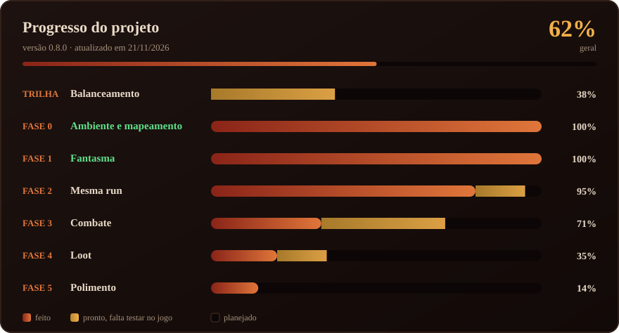

# Roadmap — Hell Clock Coop

> Atualizado em 21/11/2026 · versão 0.7.2. Gerado a partir de [`docs/roadmap.json`](docs/roadmap.json) por `scripts/gerar-progresso.py`: edite o JSON, não este arquivo.

**Legenda:** ✅ feito · 🧪 pronto, falta testar no jogo · 🔨 em andamento · ⬜ planejado

Regra do projeto: uma fase só é dada como concluída depois de confirmada **rodando no jogo**.

## Trilha permanente — Balanceamento · 43%

_Prioridade 1, trilha permanente: o coop deve ser um pouco mais difícil que o solo, com ajustes guiados por dados. Toda versão passa por revisão de balanceamento._

| | Item |
|:-:|---|
| 🧪 | Escalonamento por número de jogadores: vida, chefes, dano, quantidade de inimigos e tempo ganho |
| 🧪 | Valores ajustáveis no arquivo de configuração, sem recompilar |
| 🧪 | Resumo de balanceamento de cada run, salvo no computador |
| 🧪 | Envio anônimo dos resumos, só com aceite (Firebase, só criação) |
| ⬜ | Painel de balanceamento: solo × 2, 3 e 4 jogadores, por andar e dificuldade |
| ⬜ | Ajuste individual quando o convidado está muito abaixo ou acima do host |
| ⬜ | Jogador caído e reanimação, em vez de a morte do host encerrar a run |

## Fase 0 — Ambiente e mapeamento · 100%

_BepInEx funcionando num jogo com managed stripping, backup do save e mapa dos pontos de patch._

| | Item |
|:-:|---|
| ✅ | BepInEx 5 + bibliotecas base completas de Windows (unstripped_corlib) |
| ✅ | Backup automático da pasta de save a cada início (15 cópias) |
| ✅ | Checagem da versão do jogo e validação de todos os alvos de patch |
| ✅ | Patches de diagnóstico (spawn, run, andares, alvos, Steam) |
| ✅ | Erros da Unity copiados para o log do BepInEx |

## Fase 1 — Fantasma · 100%

_Um jogador vê o outro andando e atacando, pela Steam._

| | Item |
|:-:|---|
| ✅ | Modo eco (F8): fantasma local para testar sem amigo |
| ✅ | Avatar-clone sem lógica, com animações sincronizadas por estado e parâmetros |
| ✅ | Mira (ossos do tronco), roupas com física (MagicaCloth) e aparência |
| ✅ | Lobby de amigos da Steam, convite, aperto de mão e checagem de versão/DLC |
| ✅ | Nome sobre a cabeça e seta verde no minimapa |

## Fase 2 — Mesma run · 95%

_O host é dono da run: todos no mesmo andar, mesmo mapa, mesmo Hell Clock._

| | Item |
|:-:|---|
| ✅ | Convidado puxado para a run do host |
| ✅ | Mesmo andar sorteado e mesmo ponto de spawn |
| ✅ | Hell Clock do host (4x por segundo) e tempo ganho pelo convidado |
| ✅ | Fim da run do host encerra a de todos; sem pausa com aliados |
| 🧪 | Entrada no meio da run, portal vermelho e fim por tempo |

## Fase 3 — Combate · 71%

_Mesmos inimigos para todos, cada um vê as skills do outro, inimigos atacam qualquer jogador._

| | Item |
|:-:|---|
| ✅ | 3a: inimigos do host replicados no convidado (tipo, afixos, vida, animação) |
| ✅ | 3a: dano do convidado aplicado pelo host; morte vale para todos |
| 🧪 | Baús iguais para todos e vasos/caixas quebrados para todos |
| ✅ | 3b: efeitos das skills (tiros, projéteis, áreas, auras, orbes) no avatar |
| ✅ | 3b: números de dano dos aliados, com cor própria por aliado |
| 🧪 | 3b: facas que giram e estacas cravadas nos inimigos |
| 🧪 | 3c: inimigos atacam o convidado, com o dano calculado no jogo dele |
| 🧪 | 3c: convidado que morre volta no próximo andar do host |
| 🧪 | Santuários e totens de bênção compartilhados |
| 🧪 | Chefe no convidado: fase agressiva, barra de vida e dano |
| ⬜ | Status do convidado (lentidão, congelamento) valendo no host |
| ⬜ | Boneco de DPS do hub visível para o outro |

## Fase 4 — Loot · 35%

_Progressão individual: cada um ganha o próprio loot, ouro e XP, no próprio save._

| | Item |
|:-:|---|
| ✅ | Loot e XP de cada inimigo morto saem do jogo de cada um |
| 🧪 | Loot próprio de baús e quebráveis |
| ⬜ | Revisar XP de inimigos mortos longe do jogador |
| ⬜ | Revisar drops de invocações, ondas de sobrevivência e temporadas |
| ⬜ | Auditoria: o mod nunca escreve no save de outro jogador |

## Fase 5 — Polimento · 0%

_Deixar o coop confortável para qualquer pessoa instalar e jogar._

| | Item |
|:-:|---|
| ⬜ | Menu de coop dentro do jogo (no lugar das teclas F6/F7) |
| ⬜ | Reconexão e troca de host sem perder a run |
| ⬜ | Sons das skills e dos golpes dos aliados |
| ⬜ | Dificuldade ajustada ao número de jogadores |
| ⬜ | Desempenho com 4 jogadores e muitos inimigos |
| ⬜ | Tradução para inglês e instalador |
